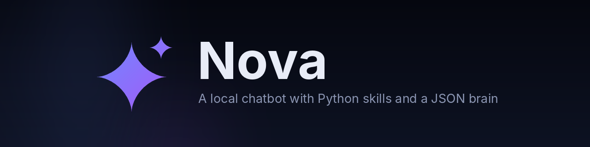
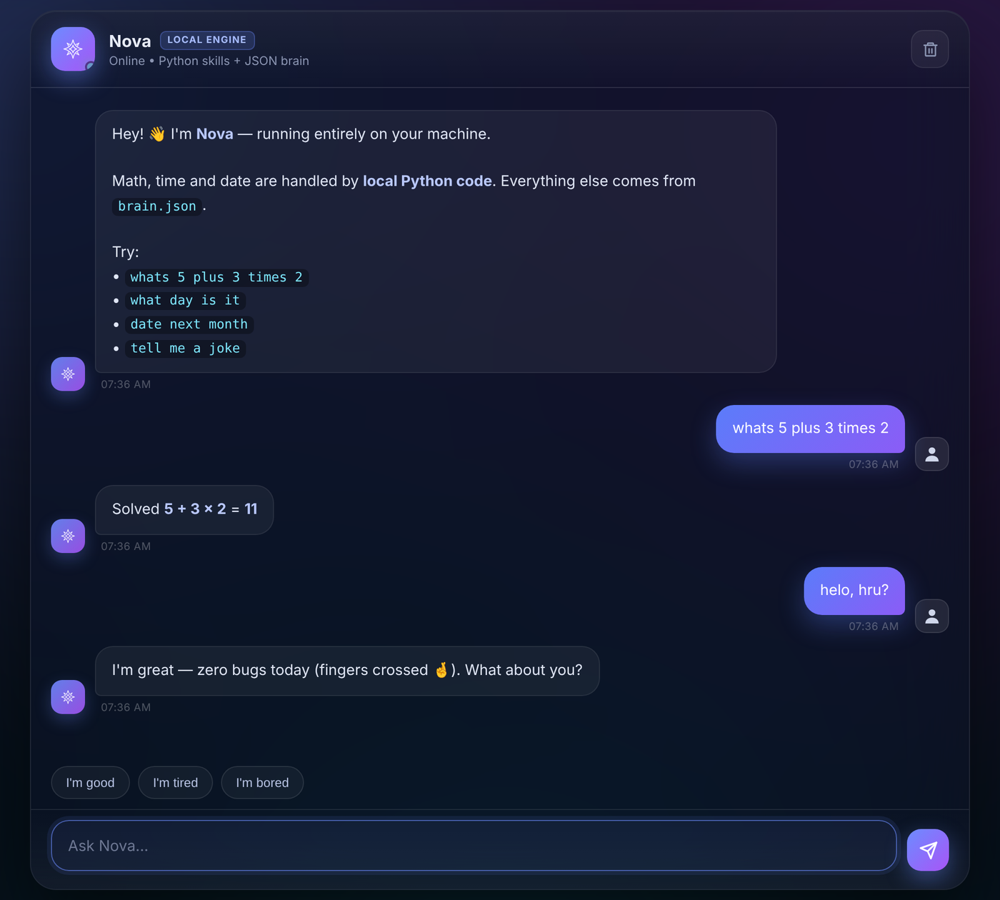
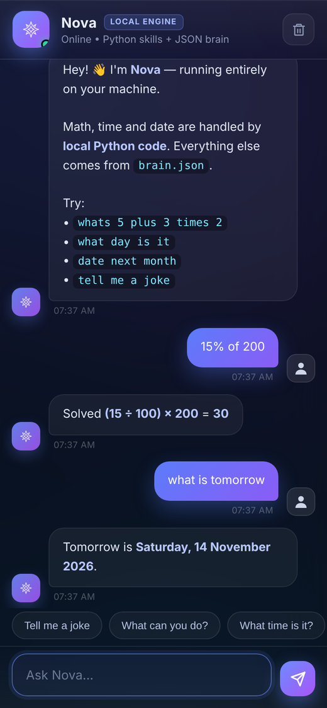

<div align="center">



<a href="CHANGELOG.md"></a> <a href="LICENSE"></a> <a href="help/installing-nova.md"></a> <a href="docs/nova.md"></a>

[English](README.md) | [中文](docs/readme/chinese.md) | [日本語](docs/readme/japanese.md) | [한국어](docs/readme/korean.md) | [Español](docs/readme/spanish.md)

</div>

# Nova

Nova is a chatbot that runs entirely on your own computer. Exact answers (arithmetic, the time, dates) come from small Python skills. Everything conversational comes from a JSON file you can edit in any text editor. There is no cloud service, API key, account or `pip install`.

<table>
<tr>
<td width="68%" valign="top"></td>
<td width="32%" valign="top"></td>
</tr>
</table>

## Contents

- [Overview](#overview)
- [Quick start](#quick-start)
- [Using Nova](#using-nova)
- [Features](#features)
- [How it works](#how-it-works)
- [HTTP API](#http-api)
- [Configuration](#configuration)
- [Repository structure](#repository-structure)
- [Java implementation](#java-implementation)
- [Testing](#testing)
- [Extending Nova](#extending-nova)
- [Limitations](#limitations)
- [FAQ](#faq)
- [Documentation](#documentation)
- [Contributing](#contributing)
- [License](#license)

## Overview

Each part of Nova is small enough to read in one sitting:

| Part | What it is | Where |
|---|---|---|
| Personality | Replies, jokes, advice and small talk as plain JSON | [`src/json/brain.json`](src/json/brain.json) |
| Logic | Message routing, math, dates and fuzzy matching in Python | [`src/py/`](src/py/) |
| Interface | One HTML file with its own CSS and JavaScript | [`src/index.html`](src/index.html) |
| Server | A standard-library HTTP server that connects them | [`server.py`](server.py) |

Questions with an exact answer are computed by code, so they are always right. Everything else goes through a fuzzy matcher over hand-written topics, so every reply can be traced to a line of JSON or Python.

| | |
|---|---|
| Version | 1.0 |
| Language | Python 3.10+ (developed and tested with 3.12); optional Java port of the two skills |
| Dependencies | None (standard library only) |
| Answer layers | math skill → time skill → JSON brain → fallback |
| Brain | 62 intents · 428 patterns · 211 replies · 61 phrase fixes · 127 typo fixes |
| Match threshold | 0.35 (word-overlap score × intent priority) |
| Server | `http.server.ThreadingHTTPServer` on `127.0.0.1:8000` |
| Frontend | One HTML file, no framework, no build step, no external requests |
| Tests | 28 `unittest` tests |
| License | [MIT](LICENSE) |

## Quick start

Requirements: Python 3.10 or newer and a web browser. A JDK is needed only for the optional Java demo.

```bash
git clone https://github.com/gelowie/nova-chatbot.git
cd nova-chatbot
python server.py        # on macOS, Linux and Termux you may need: python3 server.py
```

Open <http://127.0.0.1:8000> in your browser and stop the server with `Ctrl+C`. To check that it is running:

```bash
curl http://127.0.0.1:8000/health      # {"ok":true}
python -m unittest discover -s tests   # optional: run the test suite
```

More detail and troubleshooting: [installing Nova](help/installing-nova.md).

## Using Nova

| You type | Handled by | Example reply |
|---|---|---|
| `whats 5 plus 3 times 2` | math skill | Solved **5 + 3 × 2** = **11** |
| `15% of 200` | math skill | Solved **(15 ÷ 100) × 200** = **30** |
| `100 / 0` | math skill | I can't divide by zero — that one breaks the universe. |
| `what time is it` | time skill | It's **15:03** on your system clock. |
| `what day is tomorrow` | time skill | Tomorrow's weekday and date |
| `what is the date in 3 weeks` | time skill | The date three weeks from today |
| `helo` / `hru` / `sup` | JSON brain | A greeting or "how are you" reply |
| `tell me a joke` | JSON brain | One of the stored jokes |
| `see you tomorrow` | JSON brain | A goodbye, not a date |
| `asdfghjkl` | fallback | "I didn't catch that", with suggestions |

More phrases and the chat page's controls: [how to use Nova](help/how-to-use-nova.md).

## Features

**Math skill.** Arithmetic from symbols or words (`24 * 7 + 3`, `2^10`, `5 × 3`, `144 divided by 12`, `15% of 200`, `3 squared plus 4 squared`), with normal precedence and parentheses. Whole numbers print in full and other results keep up to 10 significant digits. Text is parsed into a syntax tree and only numbers and a whitelist of operators are evaluated; `eval()` is never used.

**Time and date skill.** Reads the computer's clock: the time, today's date and weekday, tomorrow and yesterday, one month ahead or back, and offsets such as `in 3 weeks` or `date in 5 days` (up to 10,000). Month arithmetic clamps to the end of the month once (31 Jan + 2 months = 31 Mar). Everyday chat such as `see you tomorrow` or `i have 2 days off` is left to the brain.

**JSON brain.** 62 topics covering conversation basics, everyday questions, entertainment, food and animals, feelings, and advice and learning. A topic can have several patterns, several replies (picked at random, never the same one twice in a row), a `priority` multiplier and its own quick-reply chips. See [the JSON brain](help/the-json-brain.md).

**Tolerant matching.** Typos (`helo`) and slang (`hru`, `thx`) are fixed as whole words, longest first. Messages are scored by shared-word overlap, stretched words (`heyyy`) still match, and short patterns do not fire inside longer words (`this` is not a greeting). Below a 0.35 score Nova uses its fallback instead of guessing.

**Chat interface.** A single responsive page with a welcome message, typing indicator, quick-reply chips, timestamps and a Clear button. Reply text is HTML-escaped before the few supported markers (`**bold**`, `*italic*`, `` `code` ``) are applied. The message list is an `aria-live` region, animation is disabled when the OS asks for reduced motion, and the page works both from the server and opened directly from disk.

**Server.** `POST /chat`, `GET /health` and `GET /`, with JSON error responses (`400`, `404`, `413`), CORS for `file://` use and a whitelist of static files, so source code and the brain cannot be downloaded. If the engine raises, the server still replies instead of dropping the connection.

**Privacy.** No outgoing network calls, no telemetry, nothing stored. The server binds to `127.0.0.1`; Nova has no login, so do not expose it to the internet.

## How it works

```
Browser (src/index.html) ── POST /chat ──► server.py ──► NovaEngine.respond()   (src/py/engine.py)
                                                              │
                                      1. math_solver.solve       → "math"
                                      2. time_reader.handle      → "time"
                                      3. JSON brain (fuzzy match) → "brain"
                                      4. fallback message        → "fallback"
```

1. The first layer that produces an answer wins. Skills run before the brain, so `5 + 5` is computed rather than matched to a chat topic.
2. The math skill strips filler words, turns words into symbols, validates the text, parses it into a syntax tree and evaluates only whitelisted nodes.
3. The time skill uses whole-word patterns plus a question cue, so ordinary chat is left to the brain.
4. The brain normalizes the message (lowercase, punctuation removed, typo and slang fixes), then scores it against every pattern. The best score above 0.35 picks the topic.
5. If nothing qualifies, Nova picks one of five fallback messages and offers suggestion chips.

Every reply has the same shape: `{"text", "skill", "suggestions"}`. More detail: [architecture](docs/nova.md).

## HTTP API

| Route | Purpose |
|---|---|
| `GET /` (or `/index.html`) | The chat page |
| `GET /health` | Returns `{"ok":true}` |
| `GET /docs/img/icon.png` | Nova's avatar, the only static file served |
| `POST /chat` | Send `{"message": "..."}`, receive `{"text", "skill", "suggestions"}` |

```bash
curl -s -X POST http://127.0.0.1:8000/chat \
  -H "Content-Type: application/json" \
  -d '{"message": "whats 5 plus 3 times 2"}'
```

```json
{
  "text": "Solved **5 + 3 × 2** = **11**",
  "skill": "math",
  "suggestions": ["Tell me a joke", "What can you do?", "What time is it?"]
}
```

Errors are JSON: `400` for invalid JSON, a body that is not an object, a `message` that is not a string or a negative `Content-Length`; `413` for a body over 64 KiB; `404` for any other path. An empty message is not an error and returns the fallback reply.

## Configuration

| What | Where | How |
|---|---|---|
| Address and port | top of [`server.py`](server.py) | Edit `HOST` (keep `127.0.0.1`) and `PORT` (default `8000`) |
| What Nova says | [`src/json/brain.json`](src/json/brain.json) | Edit, then restart the server |
| Fallback messages and chips | `meta.fallbacks`, `meta.unknownSuggestions` | Edit, then restart |
| Max request size | `MAX_BODY_BYTES` in `server.py` | Default 64 KiB |
| Page colours | CSS variables at the top of [`src/index.html`](src/index.html) | Change `--accent`, `--accent-2`, `--cyan`, … |

## Repository structure

```
nova-chatbot/
├── server.py                  # HTTP server and entry point
├── src/
│   ├── index.html             # Chat page (HTML, CSS, JS)
│   ├── json/brain.json        # Replies, patterns, typo and slang fixes
│   ├── py/                    # Python engine
│   │   ├── engine.py          #   routing, normalization, matching
│   │   ├── math_solver.py     #   math skill
│   │   └── time_reader.py     #   time and date skill
│   └── java/                  # Java math and time skills with a CLI demo
├── tests/test_nova.py         # Automated tests
├── docs/                      # Architecture, platform notes, translations, images
├── help/                      # Guides: install, usage, brain, creating skills
├── .github/                   # Issue forms, PR template, CI, daily checks, Dependabot
├── CHANGELOG.md
├── LICENSE
└── README.md
```

The engine is imported as `from src.py import NovaEngine`, so run `server.py` and the tests from the repository root.

## Java implementation

[`src/java/`](src/java/) holds Java versions of the math and time skills and a command-line demo. It is a partial port: it has no HTTP server and does not read `brain.json`, so it cannot hold a conversation. With the same input the two skills give the same output, except that Java computes with `double`, so whole results above 2^53 differ.

```bash
javac -encoding UTF-8 -d out src/java/*.java
java -cp out nova.NovaEngine
```

JDK 17 or newer is recommended (compiled and run on OpenJDK 21). If special characters print as `?`, run with `-Dstdout.encoding=UTF-8` (Java 19+) or switch your terminal to UTF-8.

## Testing

```bash
python -m unittest discover -s tests -v
```

The suite checks that `brain.json` is valid and has no unfinished replies; math and time answers; that ordinary chat is not mistaken for a time question; intent routing, word-boundary matching and typo handling; fallbacks; and the HTTP server (health, page, icon, chat, bad requests). It needs no running server and no extra packages. GitHub Actions runs the same tests and compiles the Java files ([`ci.yml`](.github/workflows/ci.yml)).

A second script, `python .github/scripts/check_repo.py`, checks the repository against itself: relative links and heading anchors in every Markdown file, letter case of paths, badge text against the real version, license and Python minimum, the statistics quoted in the README against `brain.json`, the HTML page (tags, ids, asset paths, JavaScript syntax), Python and Java sources, JSON and YAML files, and paths used by the workflows. It runs on every push and once a day in GitHub Actions ([`repo-check.yml`](.github/workflows/repo-check.yml)); if the daily run fails it opens an issue. Add `--external` to also check that outside links still resolve.

## Extending Nova

- **Replies, topics and typo fixes:** edit [`brain.json`](src/json/brain.json) and restart; see [the JSON brain](help/the-json-brain.md).
- **Exact-answer skills:** follow [create your own skill](help/_create-skill/create-your-own-skill.md), a walkthrough that adds a dice roller.
- **Page colours:** change the CSS variables at the top of [`src/index.html`](src/index.html).

## Limitations

- Rule-based: Nova has no language model. It matches patterns and runs small programs, so anything outside its 62 topics gets a fallback reply.
- No memory: each message is answered on its own.
- No internet access, so no live data such as weather or news, and it cannot read files or images.
- Brain matching is English-only; other alphabets and accented letters are ignored.
- Single user, single machine. The Java port covers only the math and time skills.

Known quirks (details in [is Nova any good?](help/is-nova-good.md)):

- The time skill uses the clock of the computer running the server, so `time in Tokyo` gives your local time.
- The words `date` and `clock` anywhere in a message trigger the time skill (`i have a date tonight`).
- Exponents above 64 are refused (`2 ** 100` gets a fallback reply).
- Floor division `//` is calculated correctly but echoed as `÷ ÷`.
- A broad, high-priority pattern can outrank a specific one (`help me study` gets the help text).
- The page's viewport tag disables pinch-zoom on phones.

## FAQ

**Does Nova send my messages anywhere?** No. It makes no outgoing network calls and the server listens on `127.0.0.1` only.

**How does Nova produce its replies?** They are either written in `brain.json` or computed by the math and time skills.

**Why did Nova not understand me?** Its brain has 62 topics. Add a pattern or a new topic in `brain.json` ([guide](help/the-json-brain.md)) and restart.

**Can I add my own abilities?** Yes, as small Python skills; see [create your own skill](help/_create-skill/create-your-own-skill.md).

**Does it work on my phone?** On Android through Termux; see the [Android guide](docs/compatible/android-comp.md). Other guides: [Windows](docs/compatible/windows-comp.md), [Linux and macOS](docs/compatible/linux-macos-comp.md).

**Can others on my network use it?** Not by default, and that is safer. Nova has no login; read the notes in the Android guide before changing `HOST`.

## Documentation

Everything is indexed in [`docs/_docs.md`](docs/_docs.md): [what is Nova](help/what-is-nova.md) · [why it exists](help/why-nova.md) · [is it any good](help/is-nova-good.md) · [installing](help/installing-nova.md) · [using](help/how-to-use-nova.md) · [the JSON brain](help/the-json-brain.md) · [creating a skill](help/_create-skill/create-your-own-skill.md) · [architecture](docs/nova.md) · [images and badges](docs/img/_img.md).

## Contributing

Contributions are welcome. Read the [contributing guide](.github/CONTRIBUTING.md), then open a [bug report or feature request](https://github.com/gelowie/nova-chatbot/issues/new/choose) or send a pull request. Release notes are in the [changelog](CHANGELOG.md).

## License

Nova is released under the [MIT License](LICENSE). Copyright (c) 2026 Angelo MT.
