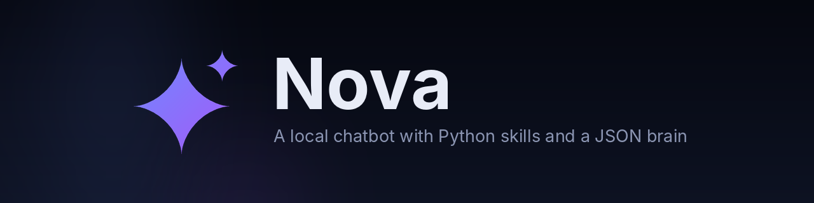

<div align="center">



<a href="../../CHANGELOG.md"></a> <a href="../../LICENSE"></a> <a href="../../help/installing-nova.md"></a> <a href="../nova.md"></a>

</div>

# Nova — Local JSON-Powered Chatbot

> Esta es una traducción del [README](../../README.md) en inglés, que es la versión de referencia. La traducción puede ir por detrás; si encuentras diferencias, abre un issue.

Un chatbot amigable y tolerante a errores de escritura que funciona **íntegramente en tu propio equipo**.
Sin APIs en la nube, sin claves de API, sin servicios de terceros y sin `pip install`.

<div align="center">

[English](../../README.md) | [中文](chinese.md) | [日本語](japanese.md) | [한국어](korean.md) | [Español](spanish.md)

</div>

## Contenido

- [¿Qué es Nova?](#qué-es-nova)
- [Características](#características)
- [Limitaciones](#limitaciones)
- [Inicio rápido](#inicio-rápido)
- [Hablar con Nova](#hablar-con-nova)
- [Cómo funciona](#cómo-funciona)
- [Estructura del repositorio](#estructura-del-repositorio)
- [Implementación en Java](#implementación-en-java)
- [Pruebas](#pruebas)
- [Ampliar Nova](#ampliar-nova)
- [Documentación](#documentación)
- [Contribuir](#contribuir)
- [Licencia](#licencia)

## ¿Qué es Nova?

Nova es un chatbot autoalojado que demuestra que no hace falta un servicio en la nube para crear un asistente amigable y útil. Todo lo que hace que funcione está en este repositorio:

- la **personalidad** (respuestas, chistes, consejos) es JSON sencillo: [`src/json/brain.json`](../../src/json/brain.json)
- la **lógica** (enrutamiento, matemáticas, fechas) es Python breve: [`src/py/`](../../src/py/)
- la **interfaz** es un único archivo HTML: [`src/index.html`](../../src/index.html)
- un pequeño **servidor** que usa solo la biblioteca estándar los conecta: [`server.py`](../../server.py)

Nova es un proyecto de aprendizaje, una plantilla para tu propio asistente local y un compañero de chat privado: tus mensajes nunca salen de tu equipo. Consulta sus alcances en [Limitaciones](#limitaciones).

## Características

- **Sin conexión y sin dependencias.** Solo la biblioteca estándar de Python.
- **Matemáticas exactas.** «whats 5 plus 3 times 2», «144 divided by 12», «15% of 200», «2^10», «3 squared plus 4 squared». Se evalúan con un recorrido restringido del árbol sintáctico; nunca se usa `eval()`.
- **Hora y fechas.** Hora actual, fecha y día de la semana de hoy, mañana/ayer, el mes que viene/pasado y desplazamientos como «in 3 weeks» (según el reloj de tu equipo).
- **Un cerebro JSON** con 62 temas de conversación: saludos, charla, sentimientos, consejos, recomendaciones, chistes (10), datos curiosos (7), citas (5) y acertijos (4).
- **Tolerancia a errores y jerga.** 127 correcciones de erratas y 61 de frases, más coincidencia aproximada: «helo», «hru», «wat r u doin» y «helloooo thereeee» funcionan.
- **Una página de chat cuidada.** Indicador de escritura, botones de respuesta rápida, marcas de hora, botón para borrar y diseño adaptable.
- **Local y privado.** El servidor escucha solo en `127.0.0.1`.

## Limitaciones

- Basado en reglas: no usa un modelo de lenguaje. Nova compara patrones y ejecuta pequeños programas.
- Sin memoria: cada mensaje se responde por separado.
- Sin acceso a internet, así que no hay datos en vivo (clima, noticias, bolsa) y no puede leer archivos ni imágenes.
- La coincidencia es solo en inglés (el cerebro ignora otros alfabetos y letras acentuadas).
- El contenido es reducido; lo que queda fuera recibe una respuesta de reserva.
- Un solo usuario y un solo equipo.
- La [implementación en Java](#implementación-en-java) solo cubre las habilidades de matemáticas y de hora.

## Inicio rápido

**Requisitos:** Python 3.10 o superior (desarrollado y probado con 3.12) y un navegador web. Solo la demostración opcional en Java necesita un JDK.

```bash
git clone https://github.com/gelowie/nova-chatbot.git
cd nova-chatbot
python server.py        # en macOS/Linux puede que necesites: python3 server.py
```

Abre <http://127.0.0.1:8000> en tu navegador. Detén el servidor con `Ctrl+C`.

Comprueba que está en marcha:

```bash
curl http://127.0.0.1:8000/health
# {"ok":true}
```

Más detalles y solución de problemas: [instalar Nova](../../help/installing-nova.md).

## Hablar con Nova

| Escribes | Nova usa | Respuesta de ejemplo |
|---|---|---|
| `whats 5 plus 3 times 2` | habilidad de matemáticas | Solved **5 + 3 × 2** = **11** |
| `15% of 200` | habilidad de matemáticas | Solved **(15 ÷ 100) × 200** = **30** |
| `100 / 0` | habilidad de matemáticas | I can't divide by zero — that one breaks the universe. |
| `what time is it` | habilidad de hora | It's **15:03** on your system clock. |
| `what is the date in 3 weeks` | habilidad de hora | That lands on **Friday, 06 November 2026** (2026-11-06). |
| `helo` / `hru` / `sup` | cerebro JSON | Un saludo o una respuesta a «¿cómo estás?». |
| `tell me a joke` | cerebro JSON | Uno de los chistes guardados. |
| `i feel great today` | cerebro JSON | Una respuesta de conversación, no una fecha. |
| `asdfghjkl` | respuesta de reserva | Un amable «no te he entendido» con sugerencias. |

Guía completa de mensajes y la API HTTP: [cómo usar Nova](../../help/how-to-use-nova.md).

```bash
curl -s -X POST http://127.0.0.1:8000/chat \
  -H "Content-Type: application/json" \
  -d '{"message": "whats 5 plus 3 times 2"}'
# {"text": "Solved **5 + 3 × 2** = **11**", "skill": "math", "suggestions": [...]}
```

## Cómo funciona

```
Browser (src/index.html) ── POST /chat ──► server.py ──► NovaEngine.respond()   (src/py/engine.py)
                                                              │
                                      1. math_solver.solve       → "math"
                                      2. time_reader.handle      → "time"
                                      3. JSON brain (fuzzy match) → "brain"
                                      4. fallback                → "fallback"
```

1. Gana la primera capa que produce una respuesta.
2. Las habilidades se ejecutan primero, así que las preguntas exactas se calculan en lugar de buscar coincidencias aproximadas.
3. El cerebro normaliza el mensaje (minúsculas, correcciones de jerga y erratas), puntúa cada patrón por solapamiento de palabras (con un refuerzo si el patrón aparece tal cual) y responde si la mejor puntuación es de al menos 0,35.
4. Cada respuesta tiene la forma `{"text", "skill", "suggestions"}`.

Explicaciones más detalladas: [arquitectura](../nova.md) y [el cerebro JSON](../../help/the-json-brain.md).

## Estructura del repositorio

```
nova-chatbot/
├── server.py                  # servidor HTTP y punto de entrada
├── src/
│   ├── index.html             # página de chat del navegador
│   ├── json/brain.json        # respuestas, patrones, correcciones de erratas y jerga
│   ├── py/                    # motor en Python (implementación compatible)
│   │   ├── engine.py          #   enrutamiento, normalización, coincidencia
│   │   ├── math_solver.py     #   habilidad de matemáticas
│   │   └── time_reader.py     #   habilidad de fecha/hora
│   └── java/                  # habilidades de matemáticas y hora en Java con demo de consola
├── tests/test_nova.py         # pruebas automáticas
├── docs/                      # documentación, traducciones, imágenes
│   ├── _docs.md               #   índice de la documentación
│   ├── nova.md                #   arquitectura y componentes
│   ├── compatible/            #   notas de compatibilidad por plataforma
│   ├── readme/                #   traducciones del README
│   └── img/                   #   banner, icono, insignias
├── help/                      #   guías (instalación, uso, cerebro, habilidades)
├── .github/                   # formularios de issues, plantilla de PR, CI, Dependabot
├── CHANGELOG.md
├── LICENSE
└── README.md
```

## Implementación en Java

[`src/java/`](../../src/java/) contiene versiones en Java de las **habilidades de matemáticas y hora** y una demostración de línea de comandos. Es una adaptación parcial: no tiene servidor HTTP ni lee `brain.json`, así que no puede mantener una conversación y no es intercambiable con el motor de Python. Con las mismas entradas, las dos habilidades producen la misma salida, salvo que Java calcula con `double`, por lo que los resultados enteros superiores a 2^53 difieren.

```bash
javac -encoding UTF-8 -d out src/java/*.java
java -cp out nova.NovaEngine
```

Se recomienda JDK 17 o superior (se compiló y ejecutó en OpenJDK 21). Si los caracteres especiales aparecen como `?`, ejecuta con `-Dstdout.encoding=UTF-8` (Java 19+) o cambia el terminal a UTF-8.

## Pruebas

```bash
python -m unittest discover -s tests -v
```

Las pruebas comprueban que `brain.json` es válido, las respuestas de matemáticas y hora, que la conversación normal no se confunda con una pregunta de hora, el enrutamiento de intenciones, el manejo de erratas, las respuestas de reserva y el servidor HTTP (estado, página, icono, chat, solicitudes incorrectas). No necesitan un servidor en marcha ni paquetes adicionales. GitHub Actions ejecuta las mismas pruebas y compila los archivos Java ([`.github/workflows/ci.yml`](../../.github/workflows/ci.yml)).

## Ampliar Nova

- **Nuevas respuestas, intenciones, correcciones:** edita [`brain.json`](../../src/json/brain.json); consulta la [guía del cerebro JSON](../../help/the-json-brain.md).
- **Nuevas habilidades de respuesta exacta:** sigue [crea tu propia habilidad](../../help/_create-skill/create-your-own-skill.md) (un tutorial probado).

## Documentación

Todo está indexado en [`docs/_docs.md`](../_docs.md): [qué es Nova](../../help/what-is-nova.md) · [por qué existe](../../help/why-nova.md) · [¿es buena Nova?](../../help/is-nova-good.md) · [instalación](../../help/installing-nova.md) · [uso](../../help/how-to-use-nova.md) · [imágenes](../img/_img.md)

## Contribuir

Las contribuciones son bienvenidas. Lee la [guía de contribución](../../.github/CONTRIBUTING.md), abre un [informe de error o una solicitud de función](https://github.com/gelowie/nova-chatbot/issues/new/choose) o envía un pull request. Consulta también el [registro de cambios](../../CHANGELOG.md).

## Licencia

Nova se distribuye bajo la [licencia MIT](../../LICENSE). Copyright (c) 2026 Angelo MT.
